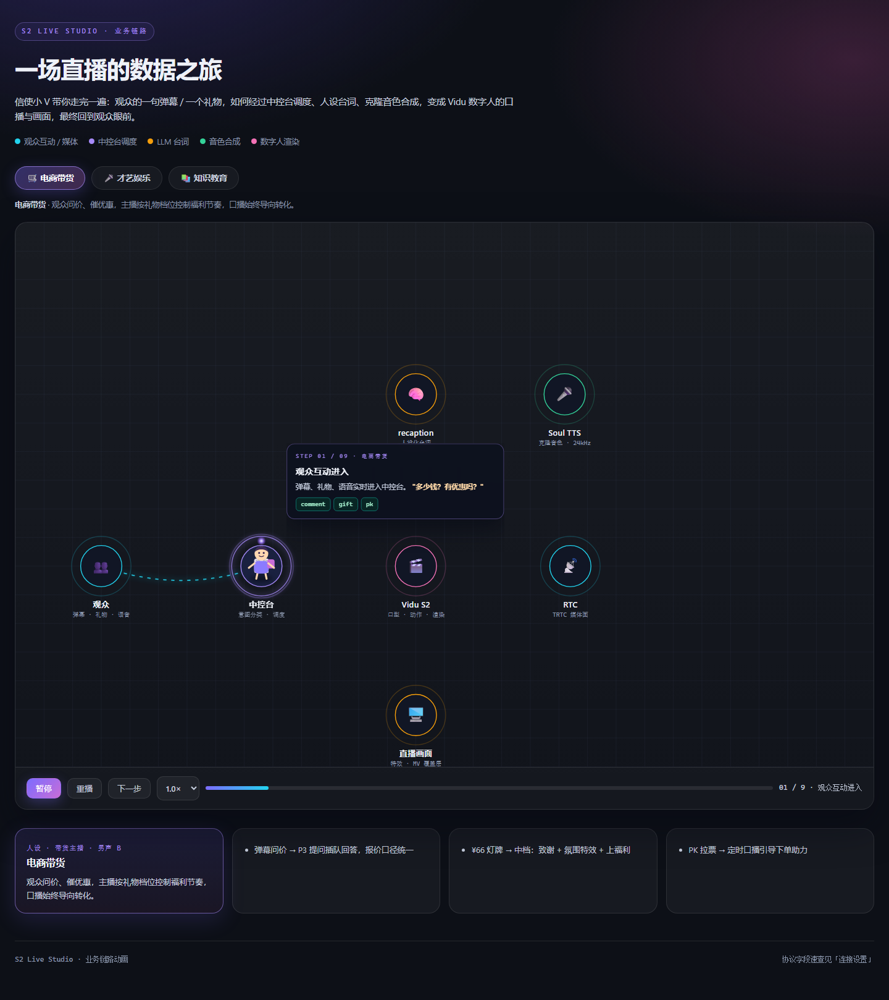
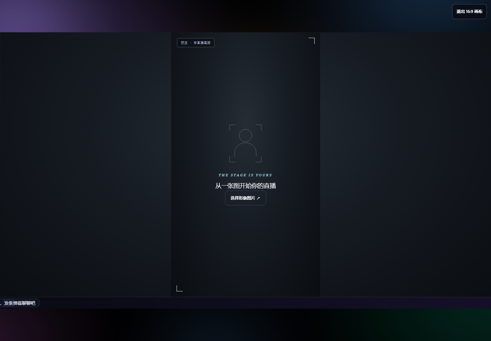

# S2 Live Studio

**Vidu S2-Avatar 组件版数字人直播工作台**  
S2 Avatar + 腾讯 TRTC + LLM + MiniMax / Soul TTS + S2 Editing，把“数字人开播”拆成一条可操作、可演示、可复用的实时互动链路。



> 当前定位：**单机、单用户、可运行的原型工作台**。默认只监听 `127.0.0.1`，不要直接暴露到公网；远程访问请放在 Nginx / Caddy 后，并加 Basic Auth 与 HTTPS。

---

## 这个项目解决什么

市面上的“数字人直播”demo 往往只演示一张会说话的图。真正开播时会遇到一串工程问题：

- 直播画面是 16:9，但数字人素材是 9:16，怎么摆？
- 弹幕、礼物、PK、才艺点播，怎么进入同一条调度链？
- 动作库、动作提示词、type 9、type 101 到底怎么配合？
- TTS 听起来像播音腔，怎么加语气词、笑声、叹气？
- 观众送了礼物，数字人怎么“更热情”，而不是每句都一个表情？
- 换装、换背景、跳舞、MV、Motion Sync，怎么不打断直播？
- 常驻观众怎么记住，下一次直播怎么接上？

S2 Live Studio 把这些拆成可替换的模块，并提供一套可以直接跑起来的中控台：

```text
弹幕 / 礼物 / 语音
        ↓
规则分类 + 人设组合策略
        ↓
LLM 台词（字幕轨 / TTS 轨 / 动作轨）
        ↓
MiniMax / Soul TTS + S2 动作库
        ↓
S2 Avatar 实时渲染 → TRTC 推流
        ↓
16:9 直播画布 / 9:16 数字人 / 底部单行弹幕
```

---

## 核心能力

| 能力 | 说明 |
|---|---|
| 16:9 直播画布 | 外层 16:9，中间 9:16 数字人，底部 34px 单行滚动弹幕 |
| 一键画布模式 | 隐藏控制台侧栏，只留直播画面，适合录屏 / 推流 / 客户演示 |
| 人设组合策略 | 教育 / 娱乐 / 带货 / 电台 / 生活；不同人设有不同语气、语速、动作密度与礼物反应 |
| 动作库 | 60 条动作，支持 type 9 匹配；`舒展肩颈`、`凑近看弹幕` 等“小动作 + 归位” |
| 自然停顿 | 参考 bencao-live-studio-public 的 NaturalPause：近期事件 + 最近动作 → LLM 选一个；无合适动作则回镜头 |
| 拉丁舞双模式 | ① 6 段 × 2s 实时动作序列；② Motion Sync 12s 参考视频（公开链接 / 本地上传） |
| 礼物事件 | 金额档位 → 动作组 + 礼物特效；大型礼物优先，避免连续重复 |
| 永久记忆 | 常驻嘉宾、偏好、未完成话题；每轮 LLM 摘要回写 |
| 声音自然度 | MiniMax 拟声标签；Soul 自动转口语填充词；字幕与 TTS 文本分离 |
| S2 Editing | 实时换装 / 换背景 / 风格迁移 / 主体替换 |
| 唱歌 / MV / 特效 | 本地 TTS 对口型、MV Agent、Motion Control / Motion Sync、具名礼物特效 |

### 16:9 画布



- 画布：16:9
- 数字人：9:16 居中
- 弹幕：底部单行滚动，不再占用右侧大块对话区
- 右上角「16:9 画布」可隐藏全部控制台 UI；开播时自动进入，结束自动退出

---

## 技术架构

```text
┌────────────────────────────────────────────────────────────┐
│                        浏览器 / 中控台                       │
│  弹幕输入 · 人设切换 · 动作库 · 拉丁舞双模式 · 礼物/事件模拟  │
└──────────────────────────────┬─────────────────────────────┘
                               │ HTTP / WebSocket
┌──────────────────────────────▼─────────────────────────────┐
│                    Node.js 单机服务 (server.js)              │
│  ┌──────────────┐  ┌──────────────┐  ┌──────────────────┐  │
│  │ 规则/人设引擎 │  │ LLM 对话/TTS │  │ S2 / TRTC / MV   │  │
│  │ interaction  │  │ ai / voices  │  │ effects / mv     │  │
│  └──────────────┘  └──────────────┘  └──────────────────┘  │
└──────────────┬──────────────────────────────┬──────────────┘
               │                              │
     ┌─────────▼─────────┐          ┌─────────▼─────────┐
     │ Vidu S2 Avatar    │          │ 腾讯 TRTC          │
     │ 动作库 / type 9   │          │ 推流 / 拉流        │
     └─────────┬─────────┘          └─────────┬─────────┘
               │                              │
               └──────────────┬───────────────┘
                              ▼
                     16:9 直播画布 / OBS / 录屏
```

### 关键设计

- **字幕轨 / TTS 轨 / 动作轨分离**：字幕干净，TTS 有笑声/叹气，动作单独用 type 9 发送。
- **动作先于 PCM**：避免说话中途插动作导致 S2 停顿；动作描述负责“缓慢回落/归位”。
- **组件版 / 实时版协议分开**：组件版用 type 9；实时版动作是 type 101，对话是 type 102，直出 TTS 是 type 100。
- **单人设 + 单动作库**：动作库按账号隔离，`library_id` 不能跨账号复用。
- **单机密钥隔离**：`config.json` 只存在本机/服务器，权限 600，不进入 Git。

---

## 快速开始

### 环境

- Node.js >= 22
- Chrome / Edge
- 一个可用的 Vidu API Key
- 一个 RTC 账号（默认腾讯 TRTC）
- 可选：LLM / MiniMax / Soul / DashScope 密钥

项目**没有 npm 依赖**，不需要 `npm install`。

### 启动

```bash
cp config.example.json config.json
# 编辑 config.json，填入自己的 Vidu / RTC / LLM / TTS 凭据

node server.js
# 或 npm start
```

打开：

```text
http://127.0.0.1:8792
```

首次启动如果相邻存在 `vidu-s1-quickstart/config.json`，会只读继承其 `vidu` 与 `rtc` 配置；独立部署请直接使用 `config.json`。

---

## 配置

`config.example.json` 是完整字段模板：

| 分组 | 用途 |
|---|---|
| `vidu` | Vidu API Key 与接入域名 |
| `rtc` | TRTC / ARTC / Agora 凭据 |
| `llm` | recaption / LLM 接口 |
| `minimax` | MiniMax TTS |
| `soul` | Soul（Loxinity）TTS |
| `vlm` | 可选视觉模型 |
| `singing` | 本地音乐目录 |
| `live` | 默认主播人设与形象 |

> `config.json` 已被 `.gitignore` 忽略，不要提交。公开仓库中不包含任何真实密钥、用户上传图片或记忆数据。

---

## 目录

```text
server.js              HTTP / WebSocket / API 服务
lib/                   对话、人设、规则、动作库、TTS、effect、MV
web/                   工作台、中控台、业务链路、播放页面
tests/                 Node 单元测试
docs/screenshots/      README 截图
NATURALNESS.md         自然度 / 动作机制说明
config.example.json    配置模板
```

---

## 部署

推荐：

```text
浏览器 → Nginx (HTTPS + Basic Auth) → 127.0.0.1:8792 → S2 Avatar / TRTC
```

`server.js` 默认只绑定 `127.0.0.1`。远程访问不要直接改成 `0.0.0.0` 裸奔。

systemd 示例：

```ini
[Unit]
Description=S2 Live Studio
After=network.target

[Service]
Type=simple
User=s2live
WorkingDirectory=/opt/s2-live/app
Environment=S2_PORT=8792
Environment=S2_PUBLIC_ORIGIN=https://your-domain.example
Environment=S2_NATURAL_PAUSE=1
ExecStart=/usr/bin/node server.js
Restart=on-failure

[Install]
WantedBy=multi-user.target
```

Nginx 需要把 `/ws/live` 的 WebSocket 升级头转发给 Node；`/voices/` 可单独作为静态音色试听页。

---

## 动作与自然度

- [自然度与动作机制说明](NATURALNESS.md)
- 60 条动作库：表情、手势、开场/收尾、坐姿、舞台、拉丁舞
- type 9 / type 101 / type 99 / type 100 / type 102 的用法与边界
- 礼物档位、动作冷却、自然停顿、MiniMax/Soul 语气词策略

---

## 项目边界

- 这是**单用户工作台**，不是多租户 SaaS；不要直接把端口暴露给不可信用户。
- S2 / TTS / LLM / 模板生成都会产生真实费用，请先在试听/演练模式验证。
- 动作“已发送”不等于动作语义完成；手指、口型、回落、自然度仍需看画面验收。
- 竖屏编舞要求全身图；半身图请用 Motion Sync，或只用上半身手势。
- 本项目不包含任何真实密钥、用户上传图片、观众记忆或个人配置。
- 第三方服务（Vidu / 腾讯 TRTC / MiniMax / Soul / 阿里云）按其各自条款计费与授权。

---

## License

暂未指定开源许可证。公开仓库用于展示与交流；商用、二次分发或大规模部署前请先联系作者确认授权。

## 相关文档

- [Vidu S2 文档](https://platform.vidu.cn/vidu-stream/doc)
- [自然度与动作机制](NATURALNESS.md)
- [bencao-live-studio-public](https://github.com/bencao-lab/bencao-live-studio-public)（自然停顿思路参考）
